# Cafetería asíncrona

Una cafetería universitaria donde pides desde el teléfono y la respuesta llega de inmediato: "pedido recibido, número 11". Desde ahí la cocina trabaja por su cuenta y el pedido avanza solo por `recibido`, `preparando` y `listo`. Nadie se queda mirando la pantalla mientras le preparan el café; la página consulta el estado cada pocos segundos y te avisa cuando puedes ir a recogerlo.

Para lograrlo, el backend no le pide nada a la cocina directamente. Guarda el pedido en Firestore, deja un mensaje en un tema de Pub/Sub y responde. Pub/Sub le entrega ese mensaje a la cocina, un servicio privado en Cloud Run que nadie más puede llamar. La plantilla trae las tres aplicaciones completas y la infraestructura del frontend y el backend; tu grupo construye en Terraform todo lo que conecta al backend con la cocina.

| Pedir | Seguir el pedido | Pantalla de la cafetería |
|---|---|---|
|  |  |  |

Si el frontend no logra hablar con el backend, lo dice en vez de quedarse en blanco:


## Arquitectura al terminar la práctica

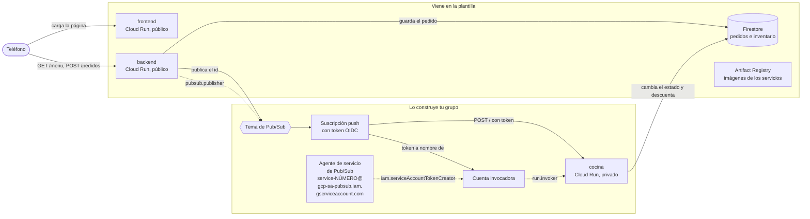

Las flechas punteadas son los permisos de IAM que da tu grupo. La etiqueta es el rol sin el prefijo `roles/` y la flecha llega al recurso sobre el que se da: el backend puede publicar solo en ese tema, el agente de Pub/Sub puede firmar tokens como la cuenta invocadora y esa cuenta puede invocar solo a la cocina.

En la plantilla, el backend ya sabe publicar, pero la variable `TEMA` está vacía: guarda el pedido, registra una advertencia y no avisa a nadie. Por eso, recién desplegada, la cafetería recibe pedidos que se quedan en `recibido` para siempre.

## Estructura del repositorio

```
backend/main.py            API en Flask: menú, pedidos, inventario y publicación en Pub/Sub
backend/requirements.txt   Dependencias del backend con versión fija
backend/Dockerfile         Imagen del backend con gunicorn
cocina/main.py             Worker que recibe las entregas push y prepara los pedidos
cocina/requirements.txt    Dependencias de la cocina con versión fija
cocina/Dockerfile          Imagen de la cocina con gunicorn
frontend/index.html        La página: vista para pedir y pantalla de la cafetería
frontend/server.py         Servidor sin dependencias que inyecta BACKEND_URL en la página
frontend/Dockerfile        Imagen del frontend
infra/providers.tf         Versión de Terraform y del proveedor de Google
infra/variables.tf         Proyecto, prefijo, región e imágenes
infra/main.tf              APIs, registro, Firestore, backend y frontend con sus cuentas
infra/outputs.tf           Ruta del registro y URL de los servicios
infra/terraform.tfvars.example   Ejemplo de valores; cópialo como terraform.tfvars
docs/api.md                Endpoints del backend y formato del mensaje de Pub/Sub
docs/estados.md            Ciclo de vida de un pedido y quién hace cada cambio
docs/capturas/             Capturas de la aplicación usadas en este README
.gitignore                 Deja por fuera el estado de Terraform, tus tfvars y __pycache__
```

## Cómo empezar

### Flujo de trabajo

1. Crea el repositorio de tu grupo con **Use this template** en GitHub.
2. Edita en VS Code o en github.dev (tecla `.` en la página del repositorio).
3. Haz commit y push desde el editor.
4. En Cloud Shell clonas la primera vez y traes los cambios con `git pull` después. Desde Cloud Shell nunca haces push.
5. Docker y Terraform se ejecutan siempre en Cloud Shell. La consola de Google Cloud es para mirar y diagnosticar, no para crear recursos.

### Primer despliegue

En Cloud Shell:

```bash
git clone https://github.com/<tu-usuario>/<tu-repositorio>.git
cd <tu-repositorio>/infra
cp terraform.tfvars.example terraform.tfvars
cloudshell edit terraform.tfvars
```

En `terraform.tfvars` pon el ID de tu proyecto y el prefijo del grupo, y ajusta las rutas de las imágenes a esos mismos valores. Este archivo vive solo en Cloud Shell: el `.gitignore` evita que llegue a GitHub.

El orden importa, porque las imágenes necesitan el registro y los servicios necesitan las imágenes:

```bash
# 1. Solo el registro (y las APIs de las que depende)
terraform init
terraform apply -target=google_artifact_registry_repository.registro

# 2. Las imágenes
REGISTRO=$(terraform output -raw registro)
gcloud auth configure-docker us-central1-docker.pkg.dev --quiet
cd ..
docker build -t $REGISTRO/backend:v1 backend
docker push $REGISTRO/backend:v1
docker build -t $REGISTRO/frontend:v1 frontend
docker push $REGISTRO/frontend:v1

# 3. Todo lo demás
cd infra
terraform apply
terraform output
```

Abre `url_frontend` en el teléfono. Si usas otra región, cambia `us-central1` en el comando de `gcloud auth configure-docker`.

Cuando cambies el código de un servicio, construye y sube la imagen con una etiqueta nueva (`v2`, `v3`...), actualízala en `terraform.tfvars` y vuelve a aplicar. Si subes otra vez la misma etiqueta, Terraform no ve ningún cambio y Cloud Run sigue con la versión anterior.

## Probar cada servicio con `docker run`

Antes de subir una imagen, pruébala en Cloud Shell. Para ver una página servida en Cloud Shell usa **Vista previa en la Web** y elige el puerto.

**Frontend.** No necesita credenciales:

```bash
docker run --rm -p 8080:8080 -e BACKEND_URL=https://<url-del-backend> $REGISTRO/frontend:v1
```

Abre la vista previa en el puerto 8080. Si no pasas `BACKEND_URL`, verás el mensaje de error de la captura de arriba.

**Backend sin Firestore.** El contenedor arranca aunque no tenga credenciales; la validación de pedidos no toca la base, así que puedes comprobarla:

```bash
docker run --rm -d --name backend -p 8081:8080 $REGISTRO/backend:v1
curl -i -X POST localhost:8081/pedidos -H 'Content-Type: application/json' -d '{"cliente": "Ana", "items": []}'
docker logs backend
docker rm -f backend
```

Debe responder `400` con el error en JSON.

**Backend con Firestore.** Cuando la base ya existe (después del primer `terraform apply` completo), puedes darle al contenedor tus propias credenciales:

```bash
gcloud auth application-default login
docker run --rm -d --name backend -p 8081:8080 \
  -e GOOGLE_CLOUD_PROJECT=<tu-proyecto> \
  -e BASE_DATOS=<prefijo>-cafeteria \
  -e GOOGLE_APPLICATION_CREDENTIALS=/adc.json \
  -v $HOME/.config/gcloud/application_default_credentials.json:/adc.json:ro \
  $REGISTRO/backend:v1
curl localhost:8081/menu
curl -X POST localhost:8081/pedidos -H 'Content-Type: application/json' \
  -d '{"cliente": "Ana", "items": [{"producto": "tinto", "cantidad": 1}]}'
```

**Cocina.** Escucha en `/` el mismo sobre que le entregaría Pub/Sub. Con las mismas credenciales, puedes hacerte pasar por Pub/Sub y entregarle a mano un pedido que esté en `recibido`:

```bash
docker build -t cocina cocina
docker run --rm -d --name cocina -p 8082:8080 \
  -e GOOGLE_CLOUD_PROJECT=<tu-proyecto> \
  -e BASE_DATOS=<prefijo>-cafeteria \
  -e GOOGLE_APPLICATION_CREDENTIALS=/adc.json \
  -v $HOME/.config/gcloud/application_default_credentials.json:/adc.json:ro \
  cocina
ID=<id de un pedido en recibido>
curl -i -X POST localhost:8082/ -H 'Content-Type: application/json' \
  -d "{\"message\": {\"data\": \"$(printf %s "$ID" | base64)\"}, \"deliveryAttempt\": 1}"
docker logs cocina
```

Responde `204` cuando termina, unos segundos después. Mira el pedido en la pantalla de la cafetería: acabas de hacer a mano lo que Pub/Sub va a hacer solo.

La cocina tiene dos variables para provocar fallas: `TIEMPO_PREPARACION` (segundos que tarda, 6 por defecto) y `PROBABILIDAD_FALLO` (entre 0 y 1; con esa probabilidad responde `500` después de haber terminado el trabajo). Los detalles están en [docs/api.md](docs/api.md) y el recorrido de un pedido en [docs/estados.md](docs/estados.md).

El plato misterioso falla siempre, y sin un tema de mensajes muertos Pub/Sub lo sigue reintentando mientras retenga el mensaje, que por defecto son 7 días. Cada intento deja un error en los logs de la cocina, así que se van a llenar hasta que tu grupo resuelva esa parte del reto.

---

# Informe del grupo

## Integrantes

| Nombre | Código | Usuario de GitHub |
|---|---|---|
| | | |

## URL de la cafetería

Frontend:

## Diagrama propio

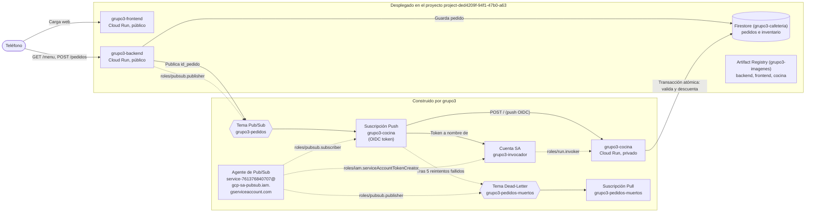

## Evidencias por fase

### Fase 0: Preparación

- Configuración activa de GCP `gcloud config list`:

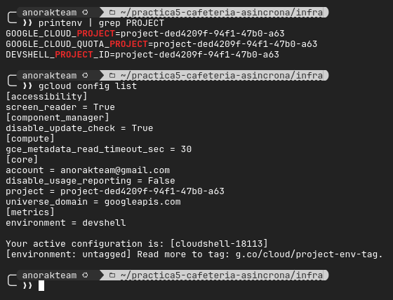

- Repositorio del grupo con colaboradores agregados:


### Fase 1: Registro, imágenes y la base

- Las tres imágenes (`backend:v1`, `frontend:v1`, `cocina:v1`) compiladas y subidas a Artifact Registry:

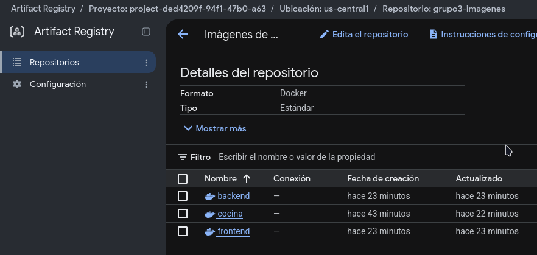

- Pedido realizado desde la web del frontend quedando en estado `recibido` de forma indefinida:

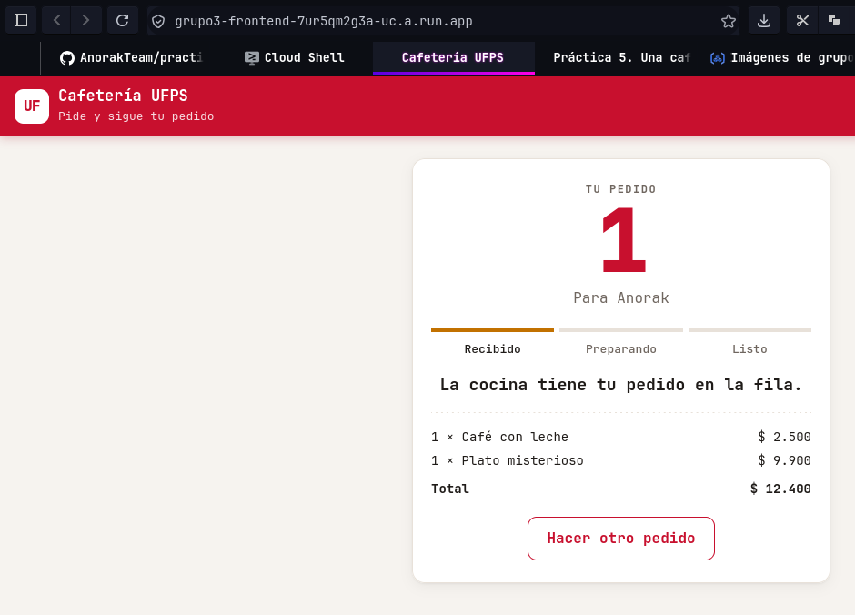

- Advertencia (`WARNING`) en los registros de Cloud Run del backend:

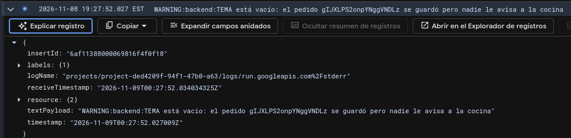

### Fase 2: El tema

- Tema de Pub/Sub creado (`grupo3-pedidos`) sin suscripciones asociadas aún en la consola:

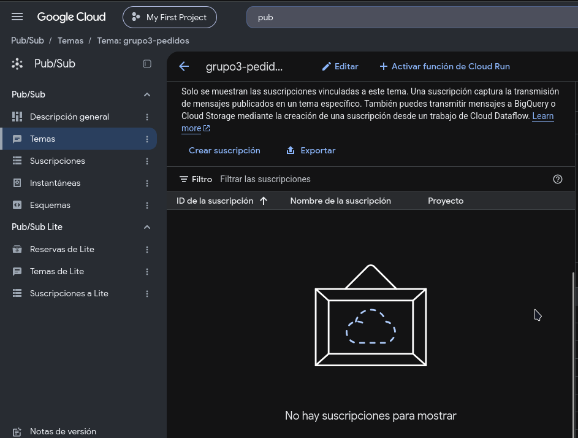

- Nuevo pedido realizado desde el frontend, el cual continúa en estado `recibido` de forma indefinida:

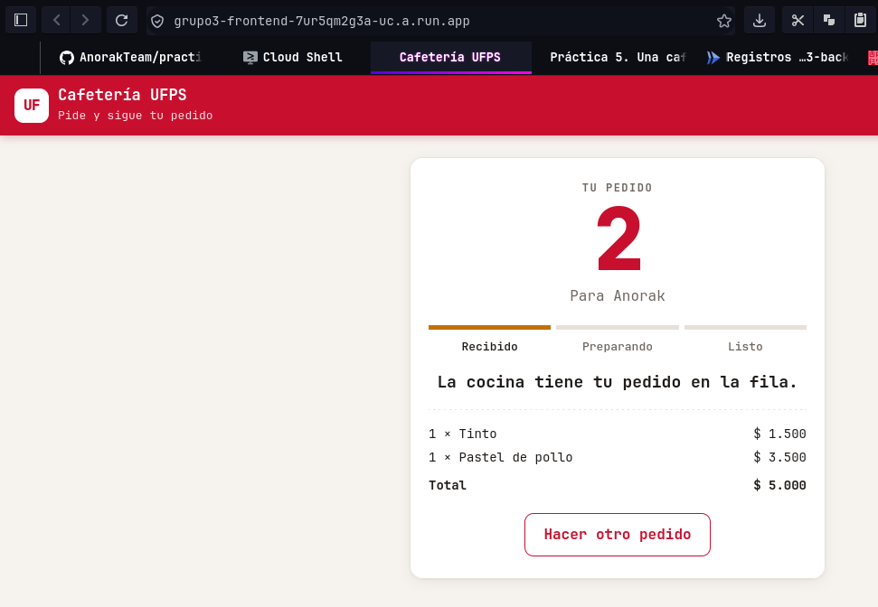

- Registro de Cloud Run del backend (`INFO:backend:Pedido ... publicado`) confirmando que el backend ya publica al tema Pub/Sub:

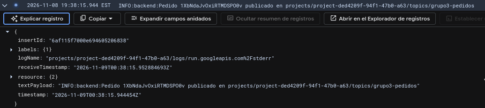

### Fase 3: La cocina privada

- Prueba de seguridad con `curl -i -X POST $C/` sobre la URL de la cocina privada, obteniendo `HTTP/2 403 Forbidden`:

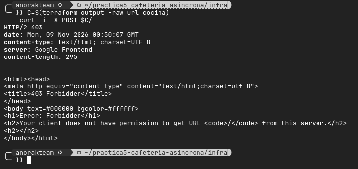

- Suscripción push (`grupo3-cocina`) creada en Pub/Sub apuntando al endpoint de la cocina con token OIDC:

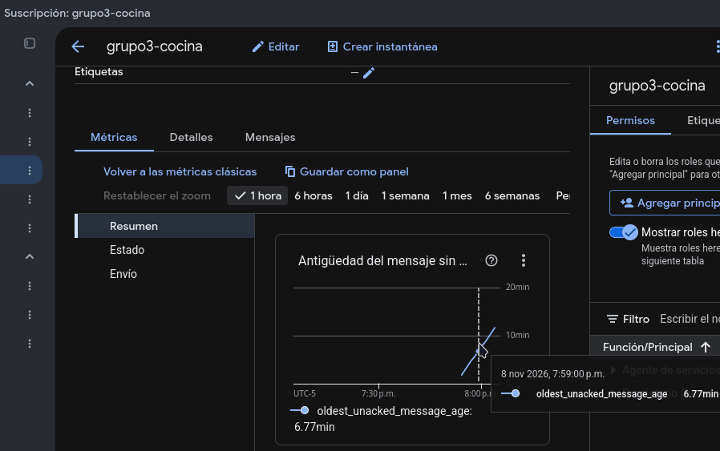

- Pedido exitoso avanzando automáticamente hasta el estado `listo`:

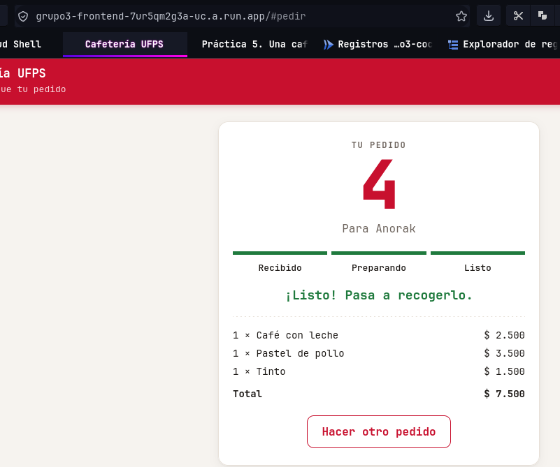

- Registro de Cloud Run de la cocina confirmando la recepción y preparación exitosa del pedido:

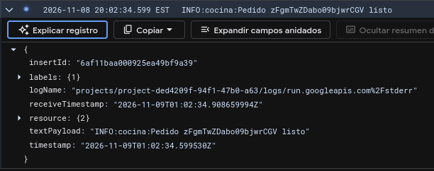

### Fase 4: Lo asíncrono, visto

- Ejecución de la ráfaga de 60 pedidos concurrentes respondiendo `201 Created` en pocos segundos:

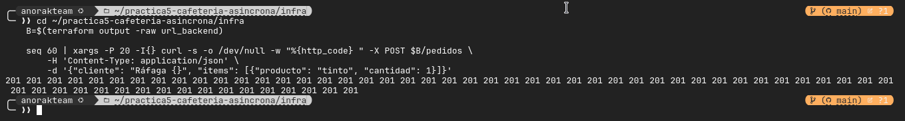

- Pantalla de la cafetería con pedidos distribuidos en las columnas procesándose en paralelo y en desorden:

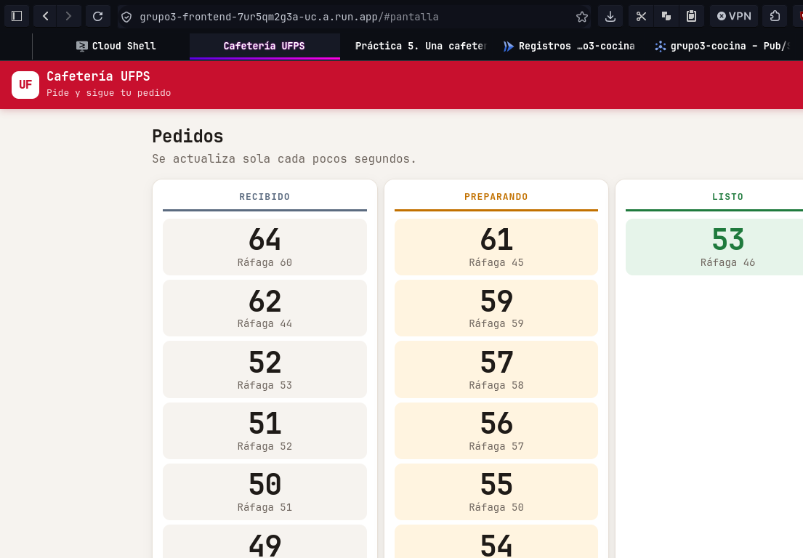

- Inventario final mostrando condición de carrera: existencias de tinto terminan en número negativo debido a la falta de operaciones atómicas entre la verificación y el descuento:

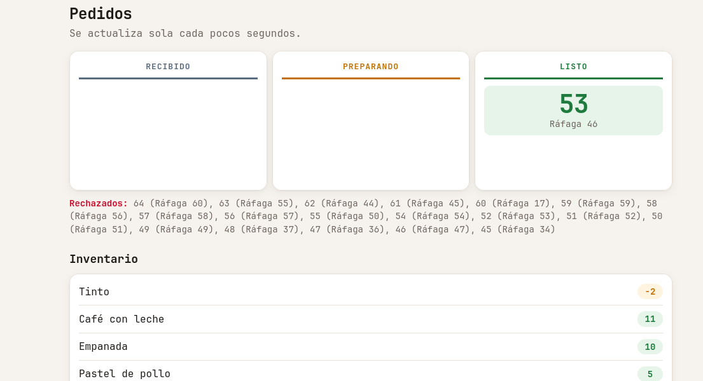

- Métricas de Pub/Sub (`grupo3-cocina`) mostrando la acumulación de mensajes no confirmados (cola) y su procesamiento:

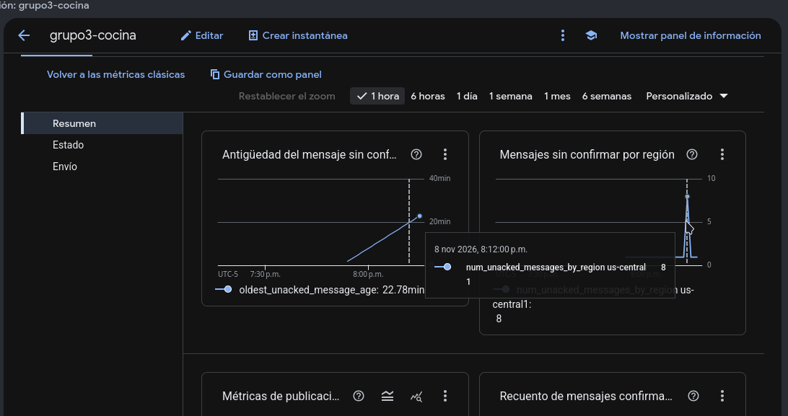

- Métricas de Cloud Run (`grupo3-cocina`) mostrando el autoescalado de instancias respondiendo a la carga:

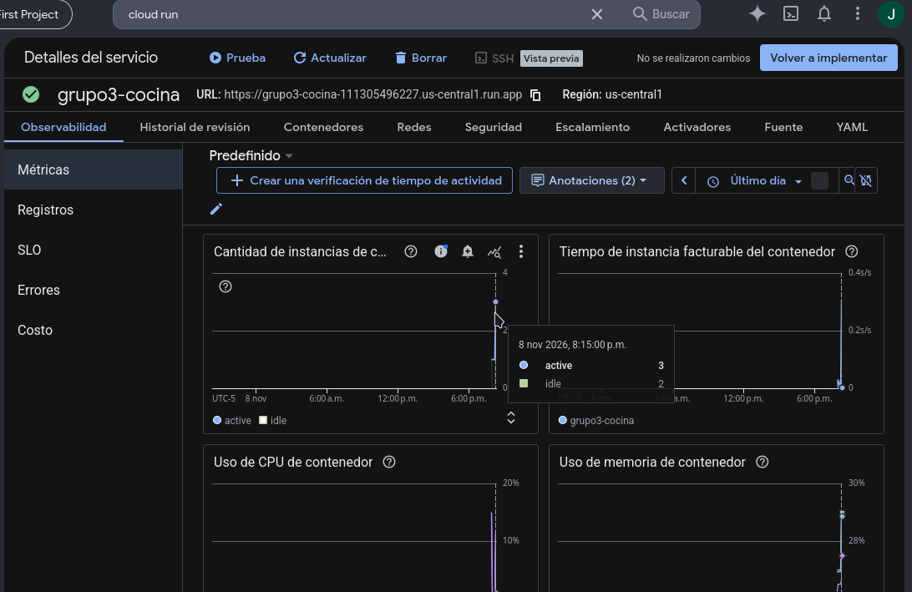

### Fase 5: Una falla a propósito

- Inventario descontado de más debido a la falla simulada (`PROBABILIDAD_FALLO = 0.5`): con 2 tandas de 4 pedidos (8 pedidos de 1 tinto en total sobre 20 iniciales), las existencias cayeron a 2 tintos en lugar de 12 (descontando 18 tintos en total por reintentos de Pub/Sub):

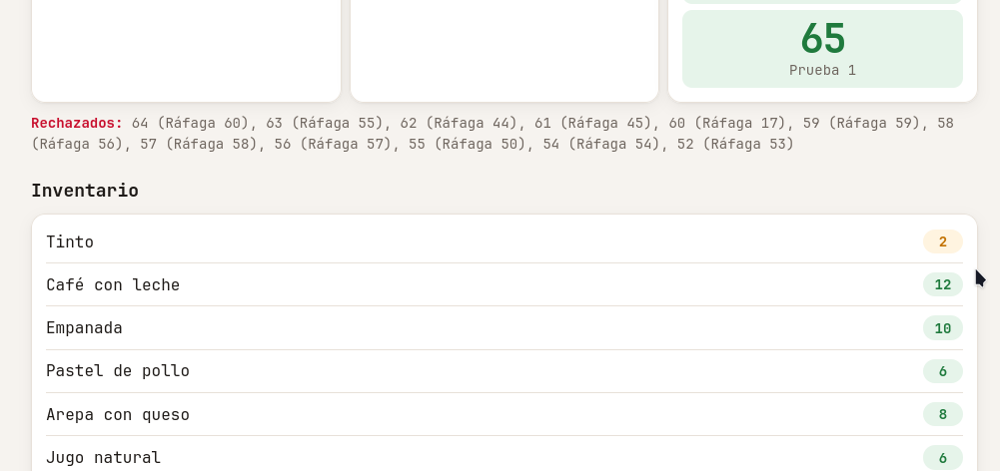

- Registros de Cloud Run (`grupo3-cocina`) evidenciando la falla simulada, la respuesta no confirmada y la reentrega de un mismo pedido por parte de Pub/Sub:

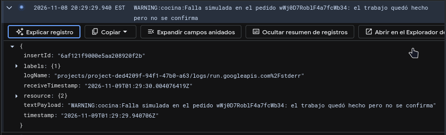

### Fase 6: Reto de la semana (Idempotencia y mensajes muertos)

- Registros de Cloud Run (`grupo3-cocina`) mostrando los reintentos controlados con número de intento explícito (del 1 al 5) ante el fallo deliberado del plato misterioso:

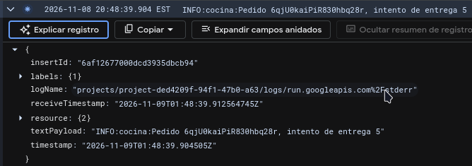

- Mensaje del pedido con el plato misterioso extraído exitosamente de la cola de mensajes muertos (`grupo3-pedidos-muertos`) tras agotarse los 5 intentos:

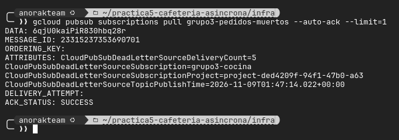

- Estado del pedido en la pantalla tras la falla repetida:

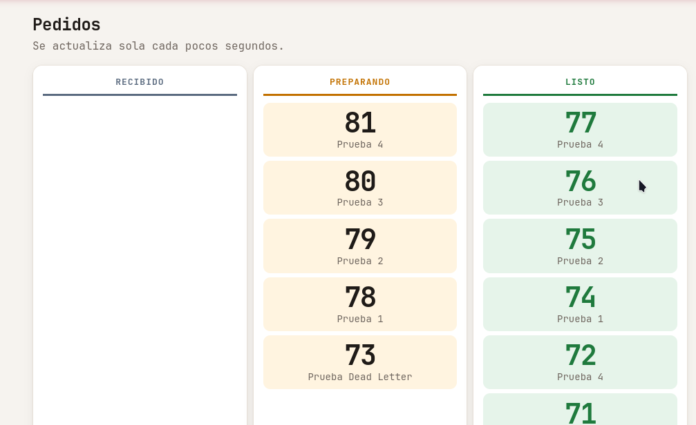

- Inventario cuadrando con precisión (16 tintos restantes tras 4 pedidos completados) gracias al control transaccional e idempotente en Firestore:

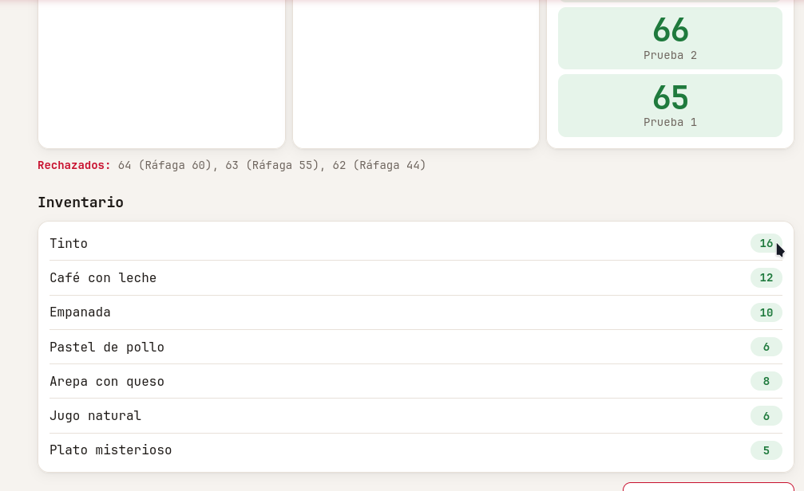

## Decisiones del reto

### 1. Idempotencia y transacciones atómicas en Firestore (`cocina/main.py`)
- **Problema previo:** En la plantilla, la cocina verificaba existencias con lecturas no atómicas y luego realizaba el descuento mediante operaciones separadas (`batch` e `Increment`). Cuando múltiples pedidos llegaban a la vez (Fase 4) o cuando un pedido era reentregado tras una falla (Fase 5), se producían condiciones de carrera que dejaban el inventario en negativo o descontaban múltiples veces el mismo pedido.
- **Implementación:** 
  1. Se añadió una verificación previa rápida: si el documento del pedido ya se encuentra en estado `listo` o `rechazado`, la función retorna inmediatamente `204 No Content`, confirmando el mensaje a Pub/Sub sin ejecutar trabajo duplicado.
  2. La validación del estado del pedido, la comprobación de existencias en `inventario` y el descuento se encapsularon en una única transacción atómica de Firestore mediante `@firestore.transactional` (`procesar_pedido_transaccional`).
  3. Dentro de la transacción se leen tanto el pedido como todos los documentos de productos solicitados. Si el pedido ya cambió de estado o las existencias son insuficientes, se actualiza a `rechazado`. Si alcanzan, se actualizan las existencias y el estado pasa a `listo` en una sola mutación atómica. Si dos instancias de Cloud Run intentan modificar el mismo producto o pedido simultáneamente, Firestore detecta la contención optimista y reintenta la transacción, garantizando consistencia estricta.

### 2. Mensajes muertos y Dead Letter Queue (`infra/pubsub.tf`)
- **Problema previo:** Si un pedido provocaba un error irrecuperable (como el plato misterioso), Pub/Sub continuaba reintentando la entrega indefinidamente (durante 7 días), saturando instancias de la cocina y llenando los registros de errores. Además, sin una política de mensajes muertos, el sobre de Pub/Sub no proporcionaba el campo `deliveryAttempt`.
- **Implementación:**
  1. Se creó el tema de mensajes muertos `grupo3-pedidos-muertos` y su correspondiente suscripción pull `grupo3-pedidos-muertos`.
  2. Se configuró `dead_letter_policy` en la suscripción de la cocina `grupo3-cocina` con `max_delivery_attempts = 5` (el valor mínimo permitido por Cloud Pub/Sub).
  3. Se otorgaron los permisos requeridos por el agente de servicio de Pub/Sub (`service-${PROJECT_NUMBER}@gcp-sa-pubsub.iam.gserviceaccount.com`):
     - `roles/pubsub.publisher` sobre el tema de mensajes muertos para poder desviar los mensajes descartados.
     - `roles/pubsub.subscriber` sobre la suscripción de la cocina para poder confirmar y extraer el mensaje cuando agota los reintentos.
  4. Gracias a esta política, Pub/Sub inyecta el número de intento real (`deliveryAttempt: 1..5`) en cada sobre push entregado a Cloud Run.

### 3. Mediciones y análisis de costos en Firestore
- **Lecturas y escrituras por pedido exitoso:**
  - *Lecturas en Backend:* 0 lecturas directas (el backend escribe el pedido con `create` y actualiza el contador de pedidos con un incremento directo).
  - *Lecturas en Cocina:* 1 lectura inicial al recibir el mensaje para comprobar el estado actual + 1 lectura del pedido dentro de la transacción + $N$ lecturas de documentos de inventario (donde $N$ es la cantidad de productos distintos en el pedido). Para un pedido típico de 1 producto (ej. tinto), son **3 lecturas de Firestore**.
  - *Escrituras en Backend:* 1 escritura del documento en `pedidos` + 1 escritura para el contador = **2 escrituras**.
  - *Escrituras en Cocina:* 1 actualización del pedido a `preparando` + 1 escritura del pedido a `listo` en la transacción + $N$ escrituras en los productos descontados del inventario = **3 escrituras** (para 1 producto).
  - **Total por pedido:** ~3 lecturas y ~5 escrituras de Firestore.
- **Comportamiento ante concurrencia:**
  - Con un máximo de 3 instancias en la cocina y 8 hilos por instancia (concurrencia de 24 pedidos en paralelo), una ráfaga de 60 pedidos tarda aproximadamente entre 18 y 22 segundos en procesar al último pedido (60 pedidos / 24 paralelos $\approx$ 2.5 lotes $\times$ 6 segundos de preparación). Si se aumenta el límite de instancias a 10, la cola se drena en un único ciclo de 6 a 8 segundos.

## Preguntas

### 1. ¿Por qué el pedido de la fase 2 nunca se preparó, aunque después crearon la suscripción?
En Google Cloud Pub/Sub, un **tema (topic)** actúa estrictamente como un canal de distribución efímero y no almacena mensajes por sí mismo; el almacenamiento y retención de mensajes reside exclusivamente en las **suscripciones**. En la Fase 2, el backend publicó exitosamente el identificador del pedido en el tema `grupo3-pedidos`, pero en ese momento el tema no tenía ninguna suscripción vinculada. Al no existir ninguna suscripción activa que capturara y almacenara una copia del mensaje, Pub/Sub descartó el mensaje de forma inmediata e irrevocable. Por esta razón, cuando en la Fase 3 se creó la suscripción push hacia la cocina, esta solo comenzó a recibir los mensajes nuevos publicados a partir de su creación, mientras que el pedido de la Fase 2 permaneció para siempre en estado `recibido` en Firestore.

### 2. Si quitan el run.invoker de la cuenta invocadora, ¿qué deja de funcionar, cuánto tarda en notarse, qué ve el cliente en el teléfono y dónde encontrarían el error?
Si se retira el rol `roles/run.invoker` de la cuenta de servicio invocadora (`grupo3-invocador`), la suscripción push de Pub/Sub ya no tendrá autorización ante Cloud Run para ejecutar peticiones HTTP hacia el servicio privado `grupo3-cocina`. El fallo se nota de inmediato en el siguiente pedido (o en cuestión de segundos, tan pronto como se propague el cambio de IAM en Google Cloud). Desde el punto de vista del cliente en el teléfono, el pedido es aceptado por el backend (`201 Created`), pero **se quedará en estado `recibido` indefinidamente**, ya que la cocina nunca llegará a recibir el mensaje para prepararlo. El cliente no verá un mensaje de error explícito en pantalla, solo la falta de avance. El error **no aparecerá en los logs de la aplicación de la cocina** (ya que Cloud Run rechaza la petición a nivel de infraestructura antes de invocar el contenedor), sino que se registraría como un código `HTTP 403 Forbidden` en el registro de solicitudes de Cloud Run (`run.googleapis.com/requests`) y como fallos de entrega por permisos en las métricas de Pub/Sub.

### 3. Con PROBABILIDAD_FALLO en 0.5, ¿cuántas veces le llega en promedio un mismo pedido a la cocina, con la cocina de la plantilla y con su cocina idempotente? Expliquen por qué los dos números son distintos y compárenlos con lo que midieron.
Con una probabilidad de fallo independiente de $p = 0.5$ en cada intento, la cantidad de entregas sigue una distribución geométrica con parámetro de éxito $1 - p = 0.5$, cuyo valor esperado teórico es de $1 / (1 - p) = 1 / 0.5 = 2$ entregas en promedio por cada pedido. Con la **cocina de la plantilla**, cada entrega repetida volvía a ejecutar el ciclo completo de preparación y el descuento ciego en Firestore, descontando inventario tantas veces como entregas ocurrieran (lo que experimentalmente en la Fase 5 provocó que 8 pedidos descontaran 18 unidades de tinto, es decir, un promedio de $18 / 8 = 2.25$ descuentos por pedido, muy cercano a la teoría). En contraste, con la **cocina idempotente**, aunque a nivel de red Pub/Sub entrega el mensaje en promedio **2 veces** (o hasta un máximo de 5 si se agotaran reintentos), para el negocio de la cocina el pedido solo se procesa efectivamente **1 sola vez**: en la primera reentrega, la cocina detecta atómicamente que el pedido ya está en estado `listo`, responde `204` de inmediato y no descuenta nada más. Así, el número de ejecuciones efectivas sobre el inventario pasa de ser una variable aleatoria con promedio 2 a ser exactamente 1.
